# dots

My Hyprland desktop config: lastshell, hyprglaze, and kitty, themed from one terminal color scheme.

https://github.com/user-attachments/assets/a05e84f3-de0e-4515-9b5c-1b01abe0dfb2

This is the configuration for `desk`, an Arch Linux machine running Hyprland.
Most of what is on screen is my own software, and this repo is where it is
wired together:

- [lastshell](https://github.com/slastra/lastshell), the shell: both bars, the dialogs, and notifications
- [hyprglaze](https://github.com/slastra/hyprglaze), the shader wallpaper that reacts to windows, the pointer, and music
- [tint](https://github.com/slastra/tint), which applies one color scheme to every app
- [hoja](https://github.com/slastra/hoja), the file manager
- [tabstrip](https://github.com/slastra/tabstrip) and [tabctl](https://github.com/slastra/tabctl), which put every browser tab in the bar and the tab switcher
- [deskvoice](https://github.com/slastra/deskvoice), the speech service behind dictation and the voice chip
- [deskpresence](https://github.com/slastra/deskpresence), the radar sensor that blanks the TV when I leave the desk
- [emotune](https://github.com/slastra/emotune), the chiptune cues

It is published to read and borrow from, not as an installer.

## Features

- **One scheme, everywhere.** A terminal color scheme colors the terminal,
  the shell, window borders, the wallpaper, GTK and Qt apps, the editors, the
  cursor, and the keyboard's LEDs. There are 366 to choose from.
- **Live preview.** The scheme picker recolors the desktop as you move through
  the list, and Escape puts the old scheme back.
- **A look on top of any scheme.** Corner radius, border thickness, which of
  the scheme's colors is the accent, and the font pair are separate settings
  with their own dialog.
- **A wallpaper that sees the desktop.** hyprglaze draws in the scheme's
  palette and reacts to windows, the pointer, and whatever is playing.
- **Everything searchable.** Apps, open windows, browser tabs, clipboard
  history, schemes, and wallpaper effects each open in the same kind of
  dialog, a keystroke away.
- **Configured in Lua.** Hyprland reloads the config when a file is saved.

## Looks

One command or one dialog recolors the whole desktop. Each shot is a terminal
color scheme paired with a hyprglaze wallpaper effect, which draws in the same
palette.

| | |
|---|---|
| 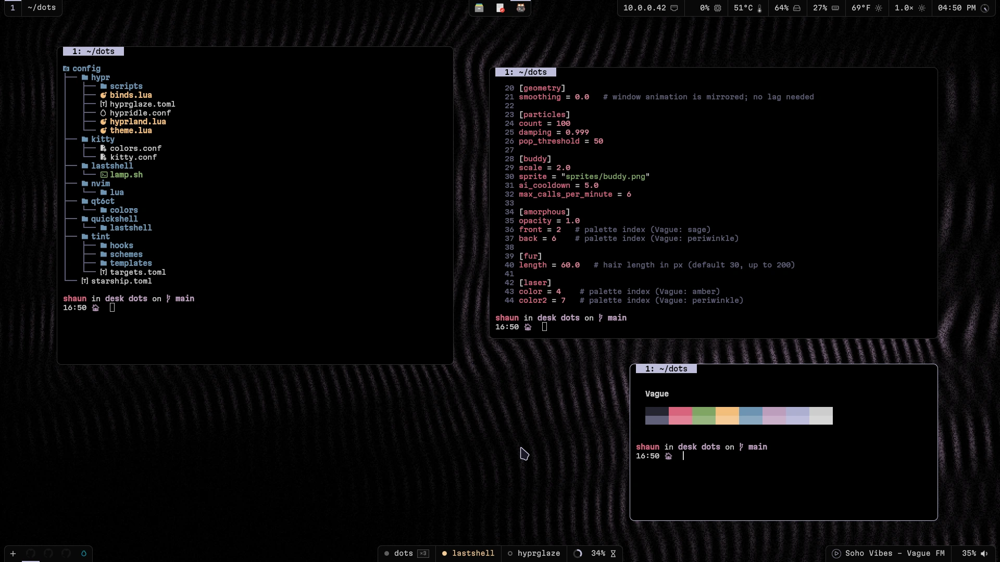 | 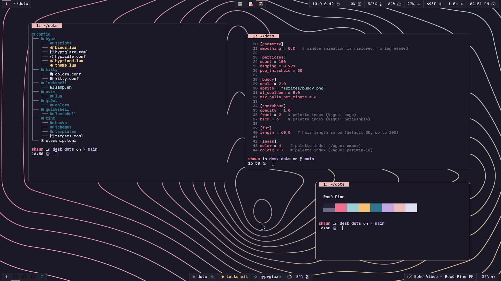 |
| Vague, `weft` | Rosé Pine, `fluid` |
| 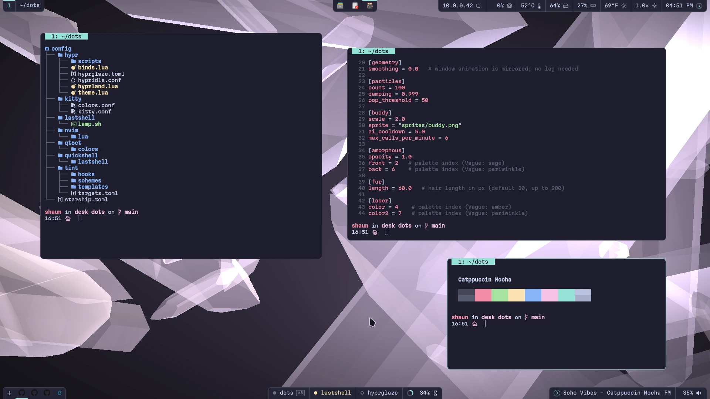 | 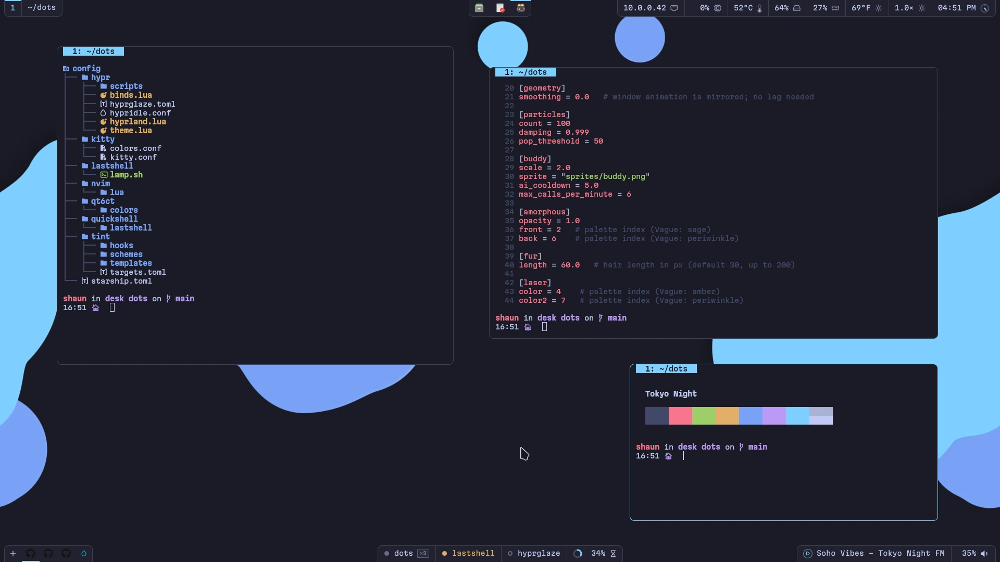 |
| Catppuccin Mocha, `crystal` | Tokyo Night, `amorphous` |
| 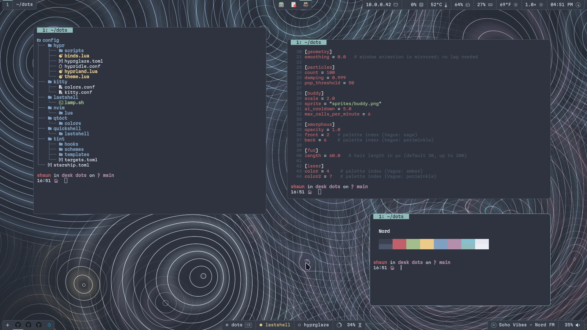 | 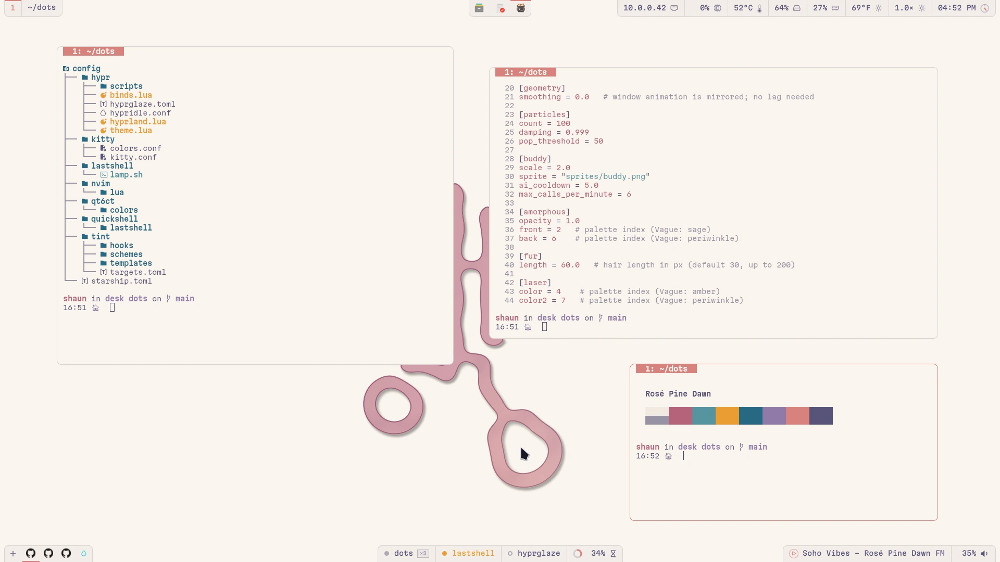 |
| Nord, `moire` | Rosé Pine Dawn, `coral` |

The shell's dialogs, in Vague:

<p>
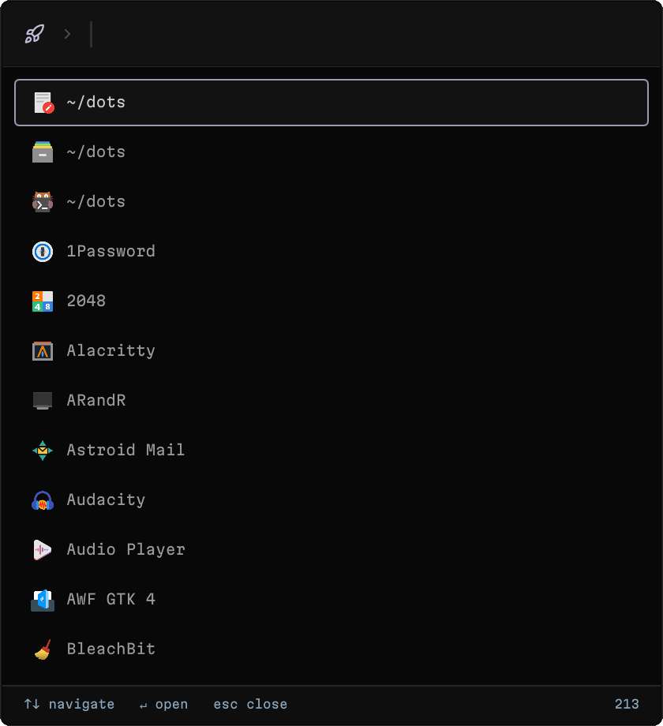
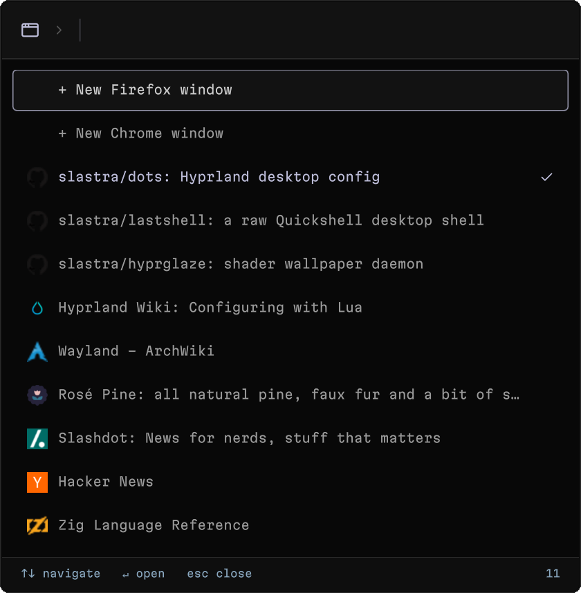
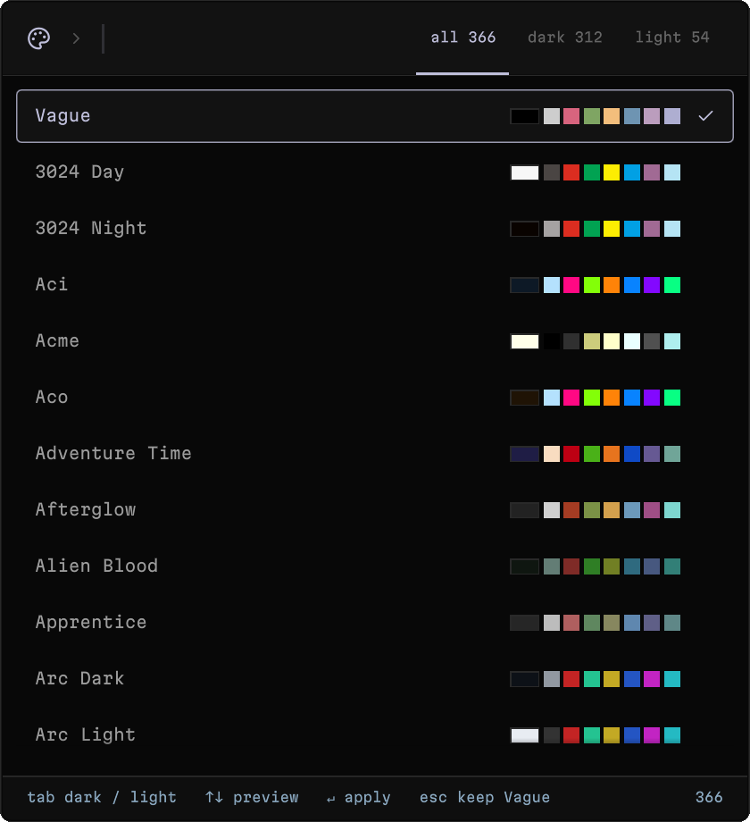
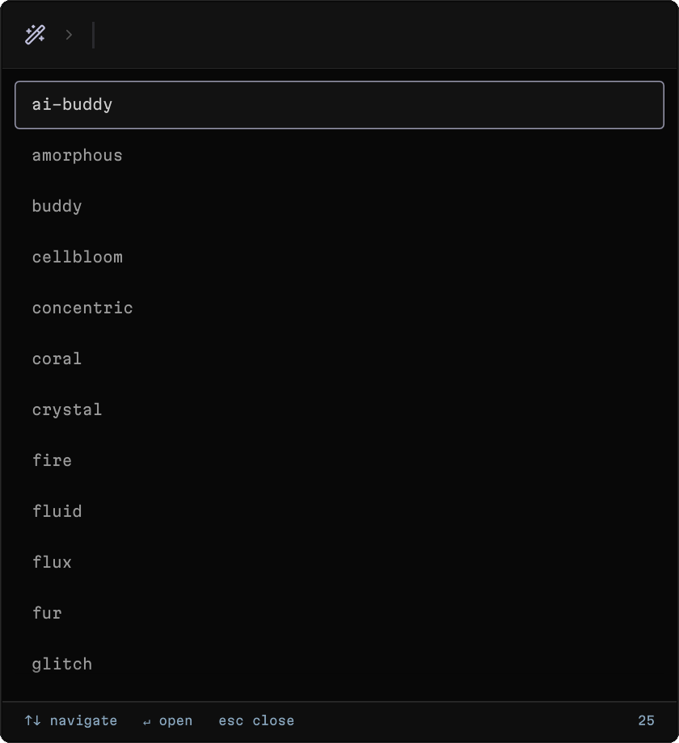
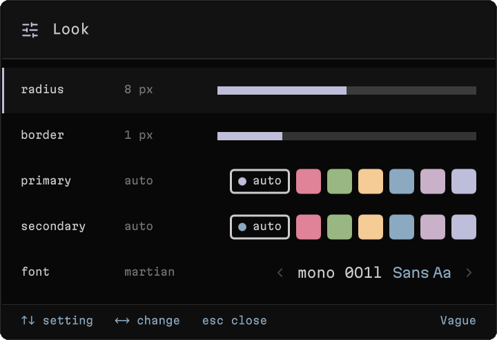
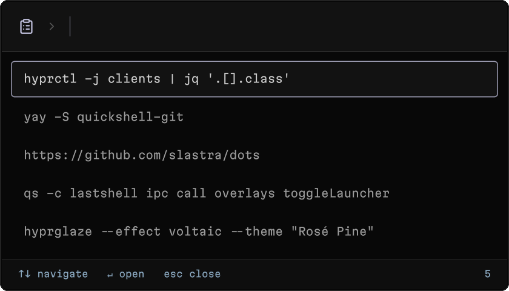
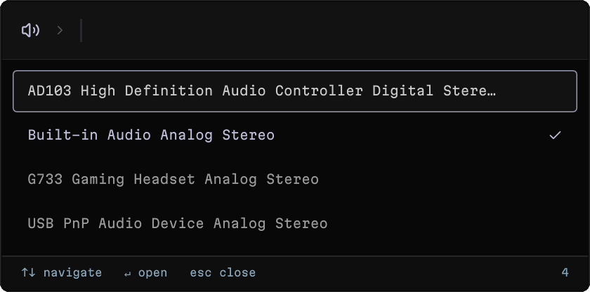
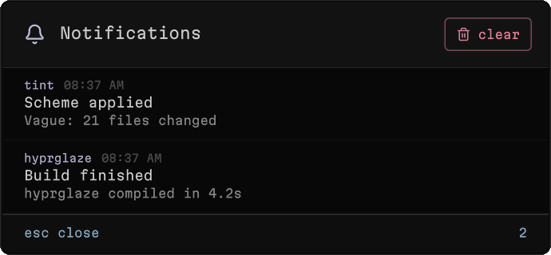
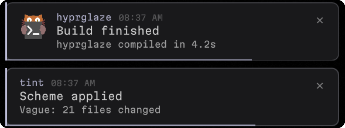
</p>

## Install

There is no install script. Each directory under `config/` mirrors a directory
in `~/.config`, so take the ones you want.

### Requirements

- Arch Linux, or another distribution with Hyprland 0.57 or newer
- [Quickshell](https://quickshell.org), kitty, hypridle, and cliphist
- The projects linked above, for the parts of the desktop each one provides
- Martian Mono and Martian Grotesk, the default font pair

### The shell

Copy `config/quickshell/lastshell` to `~/.config/quickshell/lastshell` and
start it with `qs -c lastshell`. The copy here is vendored; the
[lastshell](https://github.com/slastra/lastshell) repo is the source and has
its own setup notes.

### Theming

Install [tint](https://github.com/slastra/tint) and copy `config/tint` to
`~/.config/tint`. Run `tint check` first: targets for apps you do not have
will fail there, and can be deleted from `targets.toml`. Then `tint apply
Vague` writes the scheme into every remaining target.

### Session services

Everything but the shell is a systemd user unit on `graphical-session.target`:

```sh
systemctl --user enable hyprglaze.service hypridle.service cliphist.service   # packaged units
systemctl --user enable ~/Projects/Go/tabstrip/systemd/tabstrip.service \
    ~/.config/quickshell/lastshell/systemd/claude-status.service           # from their repos
```

## Usage

| Bind | What it opens |
|---|---|
| `SUPER + Space` | Launcher. Open windows first, by focus recency, then apps by frecency. |
| `SUPER + W` | Tab switcher. Every tab in every browser window, globally. |
| `SUPER + SHIFT + B` | Color scheme picker. Previews on the live desktop as you move; Tab narrows to dark or light. |
| `SUPER + CTRL + B` | Look dialog. Radius, border, accent colors, and the font pair. |
| `SUPER + B` | Wallpaper effect picker. |
| `SUPER + A` | Audio sink picker. `SUPER + SHIFT + A` is the per-app mixer. |
| `SUPER + V` | Clipboard history. |
| `SUPER + N` | Notification center. |
| `SUPER + /` | Hotkey sheet, parsed live from `binds.lua`, so it cannot drift. |
| `Print` | Capture menu. Stops a recording instantly if one is running. |
| `SUPER + X` | Dictation. Tap to talk, tap to stop; the transcript comes back cleaned up for the window it is headed to, and Enter pastes it there. |
| `SUPER + G` | Gathers the floating windows into one centered mosaic. |

`SUPER + T` reads the selection (else the clipboard) aloud. The player is
a chip on the bottom bar, not a dialog: hover it for the passage, progress,
speed, voice and tidy. `SUPER + SHIFT + T` pauses, `SUPER + CTRL + T` stops.

The same theming is available from a terminal:

```sh
tint apply "Tokyo Night"          # recolor everything
tint look --radius 0 --border 1   # the shape, on top of any scheme
tint list --dark                  # what there is to choose from
```

Hyprland reads the Lua files and reloads them on save, so there is no need
to run `hyprctl reload`.

## Layout

```
config/
├── quickshell/lastshell/   the shell (QML)
├── hypr/                   hyprland.lua, binds.lua, theme.lua, hypridle.conf, hyprglaze.toml, scripts/
├── lastshell/              lamp.sh (shell-adjacent)
├── tint/                   targets.toml, templates/, schemes/, hooks/ (the theming setup)
├── qt6ct/colors/           tint.conf (Qt palette, generated)
├── kitty/                  kitty.conf, colors.conf (generated, and the shell's palette source)
├── nvim/lua/               colors.lua (generated), plugins/vague.lua
└── starship.toml
hosts/lap/                  the laptop (below)
```

## Machines

`desk` drives an LG OLED TV as its monitor. The scripts that power the TV
itself on and off over the LAN, run its pixel cleaning, and blank it when the
desk is empty are described in [docs/tv.md](docs/tv.md).

`hosts/lap` is a Lenovo Slim 7 14IRP8 running the same lastshell checkout
with its own Hyprland config: time-of-flight presence, perceptual
brightness, a Wi-Fi picker, an eco mode and the root-owned power tweaks.
[docs/laptop.md](docs/laptop.md) has the details.

## How it works

### Session

greetd starts lastshell's greeter. The greeter starts Hyprland.
`hyprland.lua` starts lastshell itself (it is the session's polkit agent,
and apps it launches get their own scopes). Everything else is a systemd
user unit on `graphical-session.target`, which Hyprland 0.57 starts with
the session.

| Program | Function |
|---|---|
| `lastshell` | The shell. Two bars, the dialogs, notifications, a narrator. Quickshell. |
| `tabstrip` | Browser-tab daemon. Feeds the bar strip and the tab switcher. |
| `claude-status.py` | Claude Code session daemon, in lastshell's `scripts/`. Feeds the session chips. |
| `hyprglaze` | Shader wallpaper daemon. It draws the wallpaper. |
| `hypridle` | Idle timers (`hypridle.conf`). They report input to `deskpresence` and run `scripts/tv-watchdog.sh`. |
| `cliphist` | Clipboard history (`cliphist.service` runs the `wl-paste` watcher). |

### Theming

Nothing here is colored by hand. A scheme is 16 ANSI colors plus a background
and a foreground, and `tint apply NAME` renders it into every file listed in
`config/tint/targets.toml`. lastshell is not a target: it reads kitty's
`colors.conf` itself and gives each color one role.

[docs/how-it-works.md](docs/how-it-works.md) covers the shell's drawing, the
templates and hooks behind the theming, and the daemons that feed the bars.

## Credits

- [Vague](https://github.com/vague2k/vague.nvim), the default scheme, and
  [Gogh](https://github.com/Gogh-Co/Gogh), the collection the rest come from
- [Quickshell](https://quickshell.org), which lastshell is built on
- [Lucide](https://lucide.dev), the shell's icons
- [Papirus](https://github.com/PapirusDevelopmentTeam/papirus-icon-theme) and
  [BreezeX](https://github.com/ful1e5/BreezeX_Cursor), which the generated icon
  and cursor theme start from

## License

GPL-3.0 © 2026 Shaun Lastra. See [LICENSE](LICENSE).
