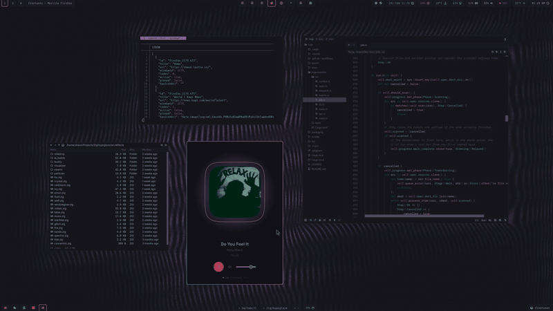

# dots

Desktop configuration for `desk`.
Arch Linux, Hyprland, Quickshell, Rosé Pine.



Full quality: [docs/demo.mp4](docs/demo.mp4).

## Session

greetd starts tuigreet. tuigreet starts Hyprland.
`hyprland.lua` then starts the desktop.

| Program | Function |
|---|---|
| `lastshell` | The shell. Two bars, nine modals, notifications, a narrator. Quickshell. |
| `tabstrip` | Browser-tab daemon. Feeds the bar strip and the tab switcher. |
| `claude-status.py` | Claude Code session daemon. Feeds the session chips. |
| `hyprglaze` | Shader wallpaper daemon. It draws the wallpaper. |
| `hypridle` | Idle timers (`hypridle.conf`). They report input to `deskpresence` and run `scripts/tv-watchdog.sh`. |
| `wl-paste` | Clipboard watcher. It stores history in `cliphist`. |

Hyprland reads the Lua files. Hyprland reloads the configuration when you save a
file. Do not run `hyprctl reload`.

## lastshell

`config/quickshell/lastshell` is the shell (a vendored copy of
[slastra/lastshell](https://github.com/slastra/lastshell), last synced at `fd18a65`). Raw Quickshell,
no framework.

The bars are tab chips hanging off the screen edges. Four instruments are
drawn, not fonted: an analog clock (hour hand only), a thermometer, a
speaker whose arcs grow with volume, and a usage ring. Icons are
[Lucide](https://lucide.dev); text is ShureTechMono. Nerd-font icon glyphs
are banned. Qt renders their private-use codepoints wrong.

The modals share one chrome: header with an identity icon and a prompt
caret, scrolling body with a gliding cursor and gold match highlighting,
hint footer, animated backdrop mask.

| Bind | Modal |
|---|---|
| `SUPER + Space` | Launcher. Open windows first, by focus recency, then apps by frecency. |
| `SUPER + W` | Tab switcher. Every tab in every browser window, globally. |
| `SUPER + A` | Audio sink picker. |
| `SUPER + B` | Wallpaper effect picker. |
| `SUPER + V` | Clipboard history. |
| `SUPER + N` | Notification center. |
| `SUPER + /` | Hotkey sheet, parsed live from `binds.lua`. It cannot drift. |
| `Print` | Capture menu. Stops a recording instantly if one is running. |
| `SUPER + X` | Dictation. Tap to talk, tap to stop; the transcript comes back cleaned up for the window it is headed to, and Enter pastes it there. |

`SUPER + T` reads the selection (else the clipboard) aloud. The player is
a chip on the bottom bar, not a modal: hover it for the passage, progress,
speed, voice and tidy. `SUPER + SHIFT + T` pauses, `SUPER + CTRL + T` stops.

Notifications are lastshell's own server: urgency-washed toasts with a
countdown ring around the dismiss button, and a history the center reads.

## Daemons

The shell renders; daemons own data. `tabstrip` (Go,
[repo](https://github.com/slastra/tabstrip)) watches browsers over D-Bus
and writes a snapshot the shell's FileView watches. The bar strip is
workspace-filtered; `tabstrip list` is the global view. `claude-status.py`
(`config/lastshell/`) watches Claude Code sessions, usage quotas, Hyprland
focus, and MQTT face state, and writes one JSON snapshot.

## Engines

Two rofi-era scripts survive as backends with the menus stripped off:
`capture.sh` (grim/slurp/satty screenshots and gpu-screen-recorder capture,
invoked by subcommand from the capture modal) and `hotkeys.py` (the live
binds.lua parser behind the hotkey sheet, `--json`).

## The TV

The display is an LG OLED. `scripts/tv-screen.sh` turns the TV itself off
and on over the LAN instead of using DPMS. A DPMS wake forces an HDMI
2.1 FRL retrain the NVIDIA driver refuses to retry, which latches the
desktop at 60 Hz. `scripts/tv-pixel-refresh.sh` runs the panel's pixel
cleaning nightly by driving the TV's own menus over the remote-control
API. `scripts/lg-ipctl.py` speaks the TV's encrypted IP-control protocol;
its key lives in `~/.config/lgtv/ipcontrol.key`, outside this repo.

`deskpresence` (radar presence) owns blanking the TV. `scripts/tv-watchdog.sh`
is the fallback: if `deskpresence` has died, it blanks the TV after 10
minutes without input. `scripts/unblank.sh` lifts lastshell's blackout
shader on input if a crash left it applied.

## Layout

```
config/
├── quickshell/lastshell/   the shell (QML)
├── hypr/                   hyprland.lua, binds.lua, theme.lua, idle.sh, scripts/
├── lastshell/              claude-status.py, lamp.sh (shell-adjacent daemons)
├── rofi/scripts/           capture.sh, hotkeys.py (engines, menuless)
├── qt6ct/colors/           rose-pine.conf (Qt palette)
├── kitty/                  kitty.conf, colors.conf
├── nvim/lua/               colors.lua
└── starship.toml
hosts/lap/                  the laptop (below)
```

## Laptop (hosts/lap)

`lap` is a Lenovo Slim 7 14IRP8 (i7-1360P, 2880×1800 40–120 Hz panel). It
runs the same lastshell checkout as the desk (one tree; `services/Host.qml`
switches the desk-only chips off) and the files under `hosts/lap/config/`
in place of the desk's `config/hypr`. `capture.sh` and `hotkeys.py` are the
desk's, unchanged.

Presence comes from the ST VL53L1 time-of-flight sensor on the Intel sensor
hub, through [deskpresence](https://github.com/slastra/deskpresence)
(`systemd/deskpresence-tof.service`): away 30 s fades and blanks the panel
through `scripts/laptop-screen.sh`; hypridle's timeouts go through
`scripts/presence-guard.sh`, so reading without touching anything isn't
idle.

Brightness steps a perceptual level (CIE L*), so 5% looks the same at the
floor as at full, and every change eases instead of jumping. The keys go
through lastshell: a tap is one step, holding glides (the ACPI video bus
reports no hold, only firmware repeats of the tap).

`SUPER + SHIFT + N` (or a click on the network chip) is the Wi-Fi picker:
joined, saved, then nearby networks by signal; a new secured one asks for
its password. `scripts/wifi.py` talks to iwd over D-Bus and is its
passphrase agent, and runs only while the picker is open or a join is in
flight.

Battery: idle went from ~9.7 W to ~2.5 W (screen dim, nothing working).
Eco mode (`scripts/eco.sh`, Super+Shift+E; the lastshell dialog on
Super+Ctrl+E) drops to power-saver, 60 Hz, no blur, animation or animated
border, and switches Bluetooth and the keyboard light off. On battery
without eco, `scripts/power-watch.sh` still turns 120 Hz, blur and
hyprglaze off. VRR stays off: it disables the panel's PSR2 self-refresh.

`hosts/lap/etc/` holds copies of the root-owned tweaks, installed by hand
with `sudo install -Dm644 <file> /etc/<same path>` (nothing here installs
them):

| File | Why |
|---|---|
| `udev/rules.d/70-lenovo-tof-sensor.rules` | The ToF sensor's streams and enable switch for the `input` group, and report latency 1000 ms so the hub batches samples (~9 wakeups/s → ~1). |
| `udev/rules.d/80-pci-runtime-pm.rules` | PCI runtime PM `auto` for every device. |
| `sysctl.d/80-power.conf` | NMI watchdog off, dirty writeback every 15 s. |
| `modprobe.d/80-audio-power.conf` | HDA codec power saving. |
| `intel_lpmd/intel_lpmd_config.xml` | intel-lpmd parks onto the E-cores (8–15) when lightly loaded, in power-saver only (~0.2 W). |
| `boot/kernel-params` | `pcie_aspm.policy=powersupersave`: without it the NVMe never reaches L1.2 and s2idle never reaches S0ix. |

`local/bin/say` is the piper one-liner Claude Code speaks through; it plays
via PipeWire (`pw-play`), since `aplay` opening the card directly knocked
the speaker sink out with EBUSY. The OpenRouter key dictation and the
reader use stays out of the repo (`~/.config/lastshell/openrouter.key`).

## Components

- [lastshell](https://github.com/slastra/lastshell), the shell itself
- [tabstrip](https://github.com/slastra/tabstrip), the browser-tab daemon
- [tabctl](https://github.com/slastra/tabctl), the D-Bus mediator underneath
- [Rosé Pine](https://rosepinetheme.com), the palette everywhere

## License

MIT
