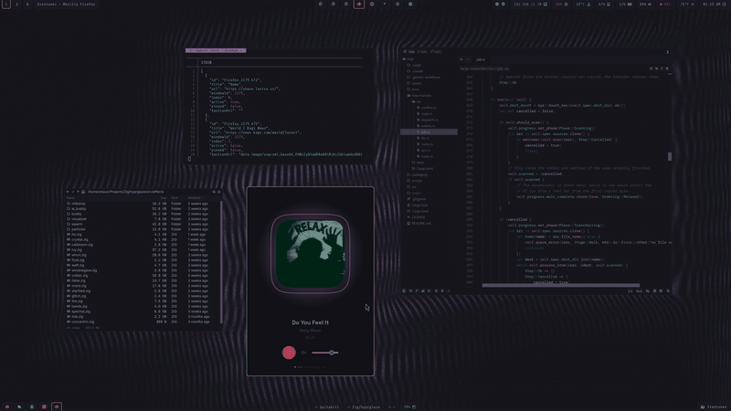

# lastshell

Quickshell desktop shell for Hyprland with two bars, eight modals, and a notification server.



Raw [Quickshell](https://quickshell.org), no framework. Rosé Pine everywhere.

## Features

The bars are tab chips hanging off the screen edges. Four instruments are
drawn with Canvas rather than fonted: an analog clock (hour hand only), a
thermometer whose mercury tracks the CPU package, a speaker whose arcs grow
with volume, and a usage ring that sweeps between quota windows. Icons are
[Lucide](https://lucide.dev); text is ShureTechMono.

The modals share one chrome: a header with an identity icon and a prompt
caret, a scrolling body with a gliding cursor and gold match highlighting,
a hint footer, and an animated backdrop mask.

Notifications are the shell's own `NotificationServer`:
urgency-washed toasts with a countdown ring around the dismiss button,
and a history the center reads.

The shell is also the session's polkit agent. Its prompt wears the modal
chrome, names the password it wants when an app's own unlock goes through
polkit (1Password's), and counts down pam_faillock's remaining attempts,
since a cancelled prompt is one of them. Stop any other agent
(hyprpolkitagent, polkit-gnome) first: a session holds one registration.

The same chrome makes a greetd login screen, in `greeter/`
([preview](greeter/preview.png)).

## Install

### Requirements

- [Quickshell](https://quickshell.org) 0.3.1, Hyprland (workspace and
  focus integration speak its IPC)
- The [Lucide](https://lucide.dev) icon font, installed as a user font
  (`lucide.ttf` from `lucide-static`)
- ShureTechMono Nerd Font for text

Some widgets pair with daemons that own their data, and degrade quietly
without them:

- [tabstrip](https://github.com/slastra/tabstrip) feeds the browser tab
  strip and the tab switcher
- [`scripts/claude-status.py`](scripts/claude-status.py) `--daemon` (run it from
  your compositor's autostart) feeds the Claude Code session chips and usage ring
- the capture and hotkey modals shell out to engine scripts (see
  [dots](https://github.com/slastra/dots) for working copies)

### The shell

```sh
git clone https://github.com/slastra/lastshell ~/.config/quickshell/lastshell
qs -c lastshell
```

The full working configuration, including the Hyprland Lua config, the
daemons, and the engine scripts, lives in
[dots](https://github.com/slastra/dots).

### The greeter

```sh
sudo bash greeter/install.sh
```

This copies the greeter to `/usr/local/share/lastshell-greeter` and points
`/etc/greetd/config.toml` at it, keeping the previous config as
`config.toml.regreet` for rollback. `greeter/harness.sh` previews it in a
nested Hyprland, in demo mode, where the password `pass` succeeds.

## Usage

| Surface | Summon |
|---|---|
| Launcher (windows first by focus recency, then apps by frecency) | `qs -c lastshell ipc call overlays toggleLauncher` |
| Tab switcher (every tab, every browser window, every workspace) | `toggleSwitcher` |
| Audio sink picker | `toggleAudio` |
| Per-app volume mixer | `toggleMixer` |
| Wallpaper effect picker | `toggleEffects` |
| Clipboard history | `toggleClipboard` |
| Notification center | `toggleNotifications` |
| Hotkey sheet | `toggleHotkeys` |
| Capture menu | `toggleCapture` |
| Eco mode (laptop) | `toggleEco` |
| Wi-Fi picker (laptop layout only) | `toggleWifi` |
| Dictation, and dictation that presses Return after the paste | `toggleDictation`, `toggleDictationSubmit` |

Bind them from your compositor config; the IPC calls are the whole
interface.

## Development

`scripts/test-harness.sh` runs the shell inside a nested Hyprland so
development never touches the session you are sitting in. grim, wtype,
and wlrctl all scope to the nested compositor. The nested output is
painted black so screenshots diff cleanly between runs, and
`LASTSHELL_PATH=<checkout>` runs another tree (a `git worktree` at an
older commit) for a before/after baseline.

On the host, give the `aquamarine` window class a rule with
`workspace = "special:harness silent"` and `render_unfocused = true`:
the first keeps a run off your screen entirely, the second keeps the
frame callbacks flowing so grim and wlrctl inside it do not hang.

## License

MIT © 2026 Shaun Lastra. See [LICENSE](LICENSE).
